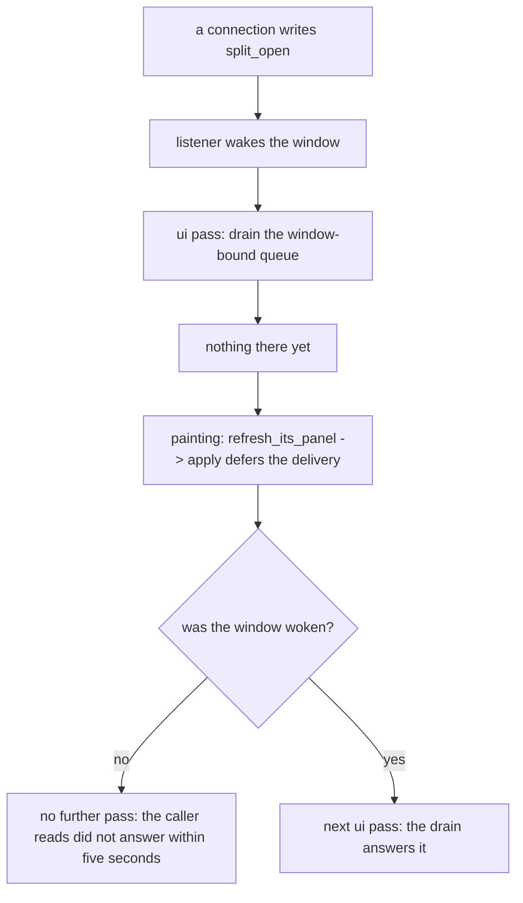

## What it does

**Any queue that a painting fills for a consumer that drains once per frame needs its own wake, and the deadline makes the missing wake look like a broken window.**

On this codebase the pipeline is: a connection's request is handed to `PaneControl` and the listener calls the wake (`ctx.request_repaint`) as it sends it; the frame's drain (`Window::answer_the_windows_requests`, called in `ui` before the tab bar) picks up what only the tree can answer; but the pane's own `PaneControl::apply` runs **during painting** (`Pane::refresh_its_panel`, reached from `painter::paint_pane` and from `Window::measure_the_ones_out_of_sight`), which is **after** that drain. So the frame that receives a `split_open` cannot answer it: the request is moved to `waiting_on_the_window` once the drain has already run. With the window at rest, no further pass is asked for, and the caller reads the listener's `ANSWER_DEADLINE` message — «the window did not answer within five seconds» — for a request queued, healthy and one frame away. That is a lie about the request, not about the window.

**The fix that shipped:** `PaneControl` keeps the same wake closure it gives the channel (`Arc<dyn Fn() + Send + Sync>`, a field, called as `(self.wake)()`) and calls it whenever a delivery is deferred — the three `split_*` verbs and `What::Closed` alike.

**How it is tested, and the trick that makes the test honest:** the arrival's wake and the deferral's wake land on the same counter, so `control::tests::a_request_that_waits_for_the_window_wakes_it` waits for the arrival's first, records the count, then calls `apply` and asserts it rose again. Mutating the deferral's wake away turns it red.

**Discarded alternative:** draining after painting, which would need the geometry a split uses to be known after the tree walk that consumes it, and would put a new panel between the paint and the press — the window the panel already documents it does not have.

## How it flows

## Where it lives

crates/app/src/control.rs — `PaneControl::apply` (the deferral and `(self.wake)()`), `PaneControl::open` (the wake kept as an `Arc`), `Window::answer_the_windows_requests` (the once-per-pass drain). Tests: `control::tests::a_request_that_waits_for_the_window_wakes_it`, `a_split_request_waits_for_the_window_instead_of_being_applied`. Related cards: the-heartbeat-was-armed-a-frame-late, a-press-cannot-see-a-newer-panel-than-the-one-painted.
