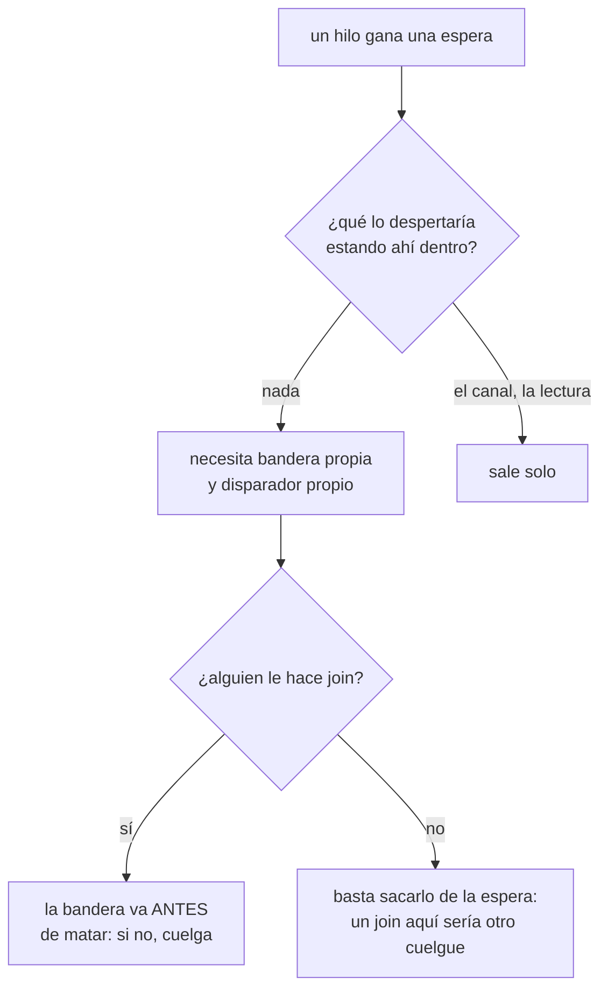

## What it does

**Aprendido cometiéndolo dentro de la propia corrección que lo señalaba.** Al dar contrapresión al terminal (D8), dos hilos ganaron una espera. Del primero se pensó desde el principio, porque su fallo era ruidoso; del segundo no, y la primera versión del arreglo lo dejaba girando para siempre. Lo cazó la revisión.

**La regla, en una frase:** un hilo que espera **no está mirando** aquello que normalmente lo despertaría. El lector no está dentro de `read`, así que el `kill` y el fin de fichero no le llegan; el del puente no está dentro del `for` sobre el canal, así que no se entera de que el programa murió. Cada espera necesita **su propia** bandera de parada y **su propio** disparador.

**Los dos casos son la misma clase de fallo, y por eso uno se vio y el otro no:**

| Hilo | Quién lo despertaría | Síntoma sin su parada |
|---|---|---|
| lector de `Pty` | nadie: `Drop` le hace `join` | **cuelga el cierre** de la ventana — ruidoso, se ve enseguida |
| hilo del `Puente` | nadie: quien hace sitio es quien recoge | **gira para siempre** — silencioso, hoy lo tapa que el proceso muera entero detrás |

El segundo es el peligroso justamente por silencioso: se convierte en una fuga por cada división que se cierre en ese instante en cuanto cerrar una división deje de cerrar el proceso (F1.4).

**Ambos comprobados, no temidos.** Quitando la bandera de `Pty`, destruirlo con el canal lleno no vuelve en 5 s. Quitando la del `Puente`, el hilo sigue vivo 5 s después de destruirlo. Cada uno tiene su prueba, y cada prueba se vio fallar antes de darse por buena.

**La trampa que casi esconde el primero:** un experimento con el canal acotado **no** se colgó, y por una razón que no se sostiene en la aplicación real — el banco de pruebas soltaba el `Receiver` antes del `drop`, y soltar el receptor despierta un `send()` bloqueado con error. Con el consumidor vivo y sin drenar, ese despertar no ocurre. **Un experimento que no cuelga no demuestra que no cuelgue: hay que mirar quién tiene el receptor.**

**Corolario sobre cómo se cierra cada uno, que no es simétrico.** Al hilo del `Puente` **no** se le hace `join`: puede estar dentro de una lectura del canal que tarde lo que tarde el programa en escribir, y esperarlo al cerrar sería cambiar un cuelgue por otro. Basta con sacarlo de la espera; del resto sale solo. Al de `Pty` sí se le hace `join`, y por eso su bandera se levanta **antes** del `kill`.

**Cómo se observa que un hilo terminó, sin contar hilos:** un testigo `Arc` capturado por el cierre que el hilo se lleva. El cierre se destruye **con** el hilo, así que su cuenta de referencias bajando a uno lo demuestra. Contar hilos del proceso mediría de rebote los del resto de la suite.

## How it flows

## Where it lives

`crates/term-core/src/lib.rs` — el campo `parar` de `Pty`, la función `entregar` que lo consulta mientras espera sitio, y `Drop for Pty`, que lo levanta antes del `kill` porque después viene un `join`. `crates/app/src/puente.rs` — el campo `parar` de `Puente`, la comprobación dentro de la espera por sitio en `Puente::nuevo`, y `Drop for Puente`, que además avisa al `Condvar` para no esperar al próximo repaso.
