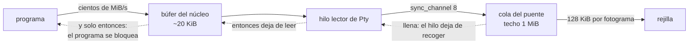

## What it does

**El desequilibrio está medido y es de dos órdenes de magnitud**: un volcado por el pseudoterminal entrega cientos de MiB/s —hasta 350 medidos con `cat /dev/zero`— y la rejilla drena **7,7 MiB/s**, los 128 KiB por fotograma a 60 por segundo. Todo lo que entra y no se drena se queda en algún sitio. El umbral exacto por debajo del cual nada crece es esos **~7,7 MiB/s de entrada sostenida**.

**Un presupuesto por fotograma no acota la memoria, y confundir las dos cosas es el error caro.** Acota cuánto *trabajo* hace un fotograma, que es para lo que se puso. Pero no frena al productor. El único freno que un terminal tiene de verdad es que el programa de dentro **se bloquee al escribir**, y eso solo pasa si alguien deja de vaciar el pseudoterminal.

**La corrección, y la regla que dejó (D8, agosto 2026).** El techo está en las **dos** colas de la cadena: `sync_channel(8)` en `Pty::spawn` —ocho lecturas de 8 KiB— y 1 MiB en la cola del `Puente`. Hacen falta las dos, y esto **no es prudencia: está medido**.

> **Poner un techo sirve si y solo si el consumidor de esa cola deja de vaciarla.** Un techo cuyo consumidor drena incondicionalmente no frena nada: solo cambia el sitio donde se acumulan los bytes.

Con el canal acotado a `sync_channel(4)` y el hilo del puente haciendo `for trozo in salida` sin pausa, `cat /dev/zero` reventaba **igual** (+525 MiB en 2,1 s); con un consumidor que pausa por fotograma, el mismo canal se queda **plano** (+716 KiB en 30 s). Un `sync_channel(4)` consumido sin pausa sostiene ~2.458 MiB/s y solo el 0,024 % de los envíos tarda más de 50 µs: el canal prácticamente nunca llega a estar lleno.

**Resultado tras la corrección**: `cat /dev/zero` pasa de +343 MiB/s a **2,7 MiB estables en 30 s**, sin perder velocidad de drenaje (los mismos ~7,6 MiB/s). El volcado acotado de 10 MiB, que antes retenía 12,9 MiB, ahora retiene 2,3 y termina en el mismo tiempo.

**Lo que sigue descartado**: descartar bytes al pasar un tope. Un terminal que pierde salida en silencio miente sobre lo que el programa escribió, y este proyecto trata los fallos silenciosos como el peor resultado posible. Con el freno no se pierde nada: lo que no cabe se queda en el programa que lo escribió, esperando — comprobado, 5 MiB escritos con el maestro sin leer y **0 bytes perdidos** al reanudar.

**Lo que la corrección NO resuelve, y conviene saber.** La forma de la API sigue invitando al fallo: `Pty::spawn` devuelve un `Receiver` y lo natural es hacerle `for`. Un consumidor nuevo con ese patrón reproduce el crecimiento íntegro **contra el código ya corregido** — 31 MB en 501 ms, demostrado. El freno protege a la instancia que existe, no al tipo.

**Cuándo dejaría de valer**: si cambia el tamaño de lectura de 8 KiB, si alguno de los dos techos se toca sin tocar el otro, o si se mide en otra máquina.

## How it flows

## Where it lives

`crates/term-core/src/lib.rs` — `Pty::spawn` con su `sync_channel(LECTURAS_EN_VUELO)` y la función `entregar`, que espera sitio y **mientras espera no lee**: ahí está el freno. `crates/app/src/puente.rs` — la constante `TECHO` y la espera del hilo en `Puente::nuevo`, la otra mitad sin la cual la primera no sirve. `crates/app/src/lib.rs` — `PRESUPUESTO`, que acota trabajo y no memoria. `crates/app/examples/fuga.rs` — el banco que produce todos estos números. `docs/02-decisiones.md` — D8.
