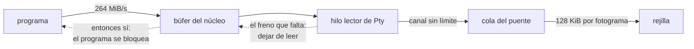

## What it does

**El desequilibrio está medido y es de dos órdenes de magnitud**: un volcado por el pseudoterminal en modo crudo entrega **264 MiB/s**, y la rejilla drena **7,7 MiB/s** —los 128 KiB por fotograma que F1.3 eligió como presupuesto, a 60 fotogramas por segundo—. Todo lo que entra y no se drena se queda en algún sitio.

**Un presupuesto por fotograma no acota la memoria, y confundir las dos cosas es el error caro.** Acota cuánto *trabajo* hace un fotograma, que es para lo que se puso: mantiene la ventana viva durante un volcado. Pero no frena al productor. Cuando el bucle de F1.3 se llevaba la cola entera a su búfer antes de aplicar el tope, lo único que conseguía era **duplicar** el montón mientras duraba — el gasto ya estaba hecho antes de llegar al presupuesto. Pedir con máximo arregla la duplicación; el montón sigue creciendo.

**Dónde está el único freno real, y por qué no está donde uno lo busca.** La cadena es: el hilo lector de `Pty::spawn` lee del maestro y envía por un canal **sin límite**, así que nunca se bloquea al enviar → nunca deja de leer → el búfer del núcleo nunca se llena → **el programa de dentro nunca se bloquea al escribir**. Ese bloqueo al escribir es el único freno que un terminal tiene de verdad, y para recuperarlo hay que dejar de leer: canal acotado en `spawn`, o un tope que el consumidor pueda expresar. **Está en `term-core`, no en quien pinta** — por eso ninguna cantidad de cuidado en el bucle lo resuelve.

**Lo que está descartado**: descartar bytes al pasar un tope. Un terminal que pierde salida en silencio miente sobre lo que el programa escribió, y este proyecto trata los fallos silenciosos como el peor resultado posible.

**Qué caso aceptar y cuál no.** F1.3 aceptó a conciencia el volcado que **termina**: un `cat` de 10 MiB retiene ~10 MiB y se ve con ~1,3 s de retraso; el criterio pedía no congelarse y no se congela. El caso que **no termina** —`yes`, `cat /dev/urandom`— agota la memoria y no estaba sobre la mesa. Queda abierto como issue #20.

**Cuándo dejaría de valer**: si `Pty::spawn` cambia a un canal acotado, si el trozo de lectura deja de ser 8 KiB, o si se mide en otra máquina.

## How it flows

## Where it lives

`crates/term-core/src/lib.rs` — `Pty::spawn` y su hilo lector con `mpsc::channel` sin límite, que es donde vive el freno que falta. `crates/app/src/puente.rs` — `Puente::recoger`, que entrega con máximo y documenta lo que **no** arregla. `crates/app/src/lib.rs` — la constante `PRESUPUESTO` y su razón de contarse en bytes.
