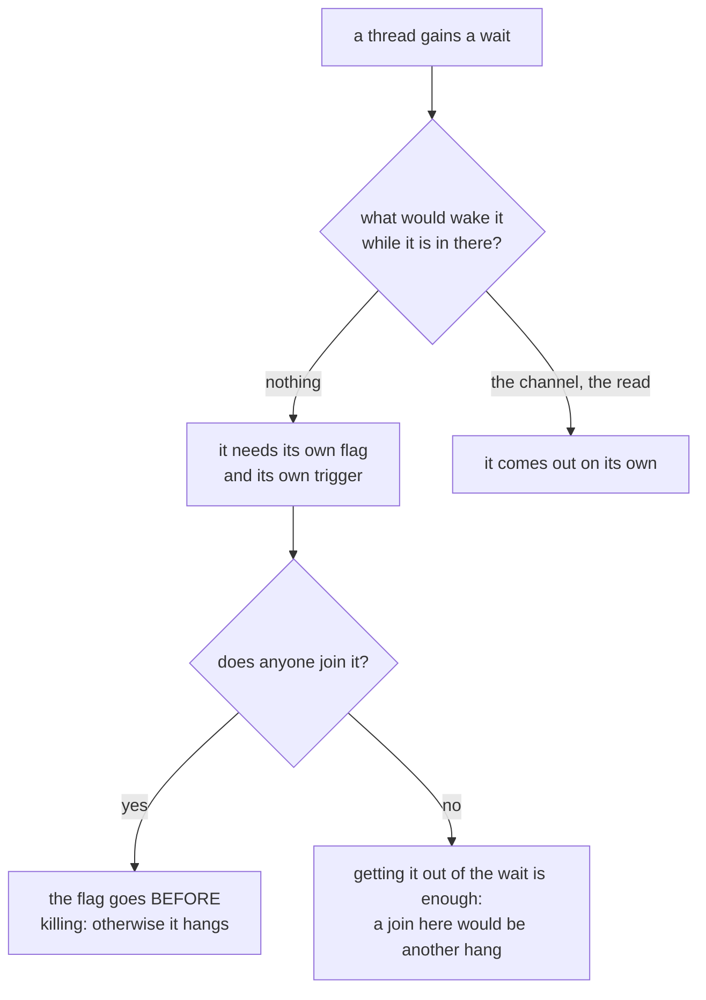

## What it does

**Learned by committing it inside the very correction that pointed it out.** On giving the terminal
backpressure (D8), two threads gained a wait. The first was thought about from the start, because
its failure was noisy; the second was not, and the first version of the fix left it spinning
forever. The review caught it.

**The rule, in one sentence:** a thread that waits **is not looking at** the thing that would
normally wake it. The reader is not inside `read`, so the `kill` and the end of file do not reach
it; the bridge's one is not inside the `for` over the channel, so it does not find out that the
program died. Every wait needs **its own** stop flag and **its own** trigger.

**The two cases are the same class of failure, and that is why one was seen and the other was not:**

| Thread | Who would wake it | Symptom without its stop |
|---|---|---|
| `Pty` reader | nobody: `Drop` does a `join` on it | **hangs the closing** of the window — noisy, seen straight away |
| `PtyOutput` thread | nobody: whoever makes room is whoever collects | **spins forever** — silent, today covered up by the whole process dying afterwards |

The second is the dangerous one precisely because it is silent: it becomes a leak for every pane
closed at that instant as soon as closing a pane stops closing the process (F1.4).

**Both verified, not feared.** Removing `Pty`'s flag, destroying it with the channel full does not
return in 5 s. Removing the `PtyOutput`'s, the thread is still alive 5 s after destroying it. Each
one has its test, and each test was seen to fail before being taken as good.

**The trap that almost hid the first one:** an experiment with the bounded channel did **not** hang,
and for a reason that does not hold in the real application — the test bench dropped the `Receiver`
before the `drop`, and dropping the receiver wakes a blocked `send()` with an error. With the
consumer alive and not draining, that waking does not happen. **An experiment that does not hang
does not prove that it will not hang: you have to look at who holds the receiver.**

**A corollary about how each one is closed, which is not symmetric.** The `PtyOutput`'s thread is
**not** joined: it may be inside a read of the channel that takes as long as the program takes to
write, and waiting for it on closing would be trading one hang for another. Getting it out of the
wait is enough; it comes out of the rest on its own. `Pty`'s is joined, and that is why its flag is
raised **before** the `kill`.

**How to observe that a thread has finished, without counting threads:** an `Arc` witness captured
by the closure that the thread takes with it. The closure is destroyed **with** the thread, so its
reference count dropping to one proves it. Counting the process's threads would measure,
second-hand, those of the rest of the suite.

## How it flows

## Where it lives

`crates/term-core/src/lib.rs` — the `parar` field of `Pty`, the `deliver` function that consults it
while waiting for room, and `Drop for Pty`, which raises it before the `kill` because a `join` comes
after. `crates/app/src/pty_output.rs` — the `parar` field of `PtyOutput`, the check inside the wait
for room in `PtyOutput::new`, and `Drop for Puente`, which additionally notifies the `Condvar` so as
not to wait for the next round.
