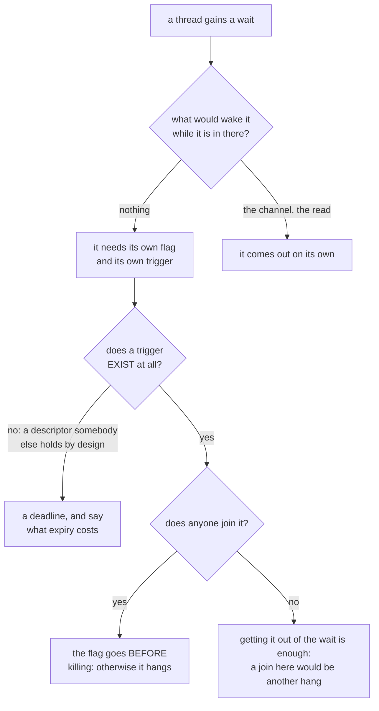

## What it does

**Learned by committing it inside the very correction that pointed it out.** On giving the terminal
backpressure (D8), two threads gained a wait. The first was thought about from the start, because
its failure was noisy; the second was not, and the first version of the fix left it spinning
forever. The review caught it.

**The rule, in one sentence:** a thread that waits **is not looking at** the thing that would
normally wake it. The reader is not inside `read`, so the `kill` and the end of file do not reach
it; the bridge's one is not inside the `for` over the channel, so it does not find out that the
program died. Every wait needs **its own** stop flag and **its own** trigger.

**The two cases are the same class of failure, and that is why one was seen and the other was not:**

| Thread | Who would wake it | Symptom without its stop |
|---|---|---|
| `Pty` reader | nobody: `Drop` does a `join` on it | **hangs the closing** of the window — noisy, seen straight away |
| `PtyOutput` thread | nobody: whoever makes room is whoever collects | **spins forever** — silent, today covered up by the whole process dying afterwards |

The second is the dangerous one precisely because it is silent: it becomes a leak for every pane
closed at that instant as soon as closing a pane stops closing the process (F1.4).

**Both verified, not feared.** Removing `Pty`'s flag, destroying it with the channel full does not
return in 5 s. Removing the `PtyOutput`'s, the thread is still alive 5 s after destroying it. Each
one has its test, and each test was seen to fail before being taken as good.

**The trap that almost hid the first one:** an experiment with the bounded channel did **not** hang,
and for a reason that does not hold in the real application — the test bench dropped the `Receiver`
before the `drop`, and dropping the receiver wakes a blocked `send()` with an error. With the
consumer alive and not draining, that waking does not happen. **An experiment that does not hang
does not prove that it will not hang: you have to look at who holds the receiver.**

**A corollary about how each one is closed, which is not symmetric.** The `PtyOutput`'s thread is
**not** joined: it may be inside a read of the channel that takes as long as the program takes to
write, and waiting for it on closing would be trading one hang for another. Getting it out of the
wait is enough; it comes out of the rest on its own. `Pty`'s is joined, and that is why its flag is
raised **before** the `kill`.

**How to observe that a thread has finished, without counting threads:** an `Arc` witness captured
by the closure that the thread takes with it. The closure is destroyed **with** the thread, so its
reference count dropping to one proves it. Counting the process's threads would measure,
second-hand, those of the rest of the suite.

## ⚠ The table above is wrong in its own first row, and #62 is the proof (September 2026)

It says the reader's symptom appears «without its stop» and is «noisy, seen straight away». **Both
halves are false, and this entry had already named the reason two rows higher without applying it to
itself.**

- **The reader HAD its flag, and it hung anyway**, because the flag is only consulted inside
  `deliver` — which the thread reaches *after* a `read` returns. Parked inside `read`, it never
  looks. The rule this entry states is «a flag **and** its own trigger»; the reader was shipped with
  the flag and **no trigger**, and that counted as done.
- **It was not seen straight away: it lived for about a month**, and for part of that time it was
  *unreachable by accident* (see [[moving-a-value-into-a-thread-moves-its-drop]]), which is worse
  than loud.
- **And there is no trigger to give it.** That is the finding, not an omission: the thread is blocked
  on a descriptor another process holds **by design**, `close()` on our clone does not unblock a
  `read` in flight, and no signal takes a descriptor back. So the third state this entry never
  considered is the real one: **a wait with a flag, no possible trigger, and therefore a deadline**.
  #62 is closed that way (**D32**): 100 ms and then the thread is abandoned.

**Corrected table:**

| Thread | Its flag | Its trigger | How it closes today |
|---|---|---|---|
| `Pty` reader, waiting for room in the channel | yes | yes — `deliver` sees it | comes out on its own |
| `Pty` reader, parked inside `read` | yes, unreachable | **none exists** | **deadline of 100 ms, then abandoned** (D32) |
| `Pty` writer, blocked in `write` | — | — | not joined; leaks for the life of the process (#159) |
| `PtyOutput` thread | yes | yes — the `Condvar` | getting it out of the wait is enough |

**The rule has now failed twice in the same crate, so it is getting a guard rather than a third
reminder** (postmortem action of #62): walk `term-core`'s production source the way `shape.rs`,
`prose.rs` and `glossary.rs` already walk `app`'s, and fail on a blocking wait — `join()`, `recv()`,
`wait()` — that is neither bounded nor accompanied by a comment declaring it deliberately abandoned.
The three existing guards are the precedent that makes this enforceable instead of aspirational.

## How it flows

## Where it lives

`crates/term-core/src/lib.rs` — the `stop` field of `Pty`, the `deliver` function that consults it while waiting for room, `READER_GIVE_UP` and `Drop for Pty`, which raises the flag before the `kill` and then waits for the reader **with a deadline**. `crates/app/src/pty_output.rs` — the stop flag of `PtyOutput`, the check inside the wait for room, and its `Drop`, which additionally notifies the `Condvar` so as not to wait for the next round.
