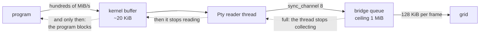

## What it does

**The imbalance is measured and it is two orders of magnitude**: a dump through the pseudoterminal delivers hundreds of MiB/s —up to 350 measured with `cat /dev/zero`— and the grid drains **7.7 MiB/s**, the 128 KiB per frame at 60 per second. Everything that comes in and is not drained stays somewhere. The exact threshold below which nothing grows is those **~7.7 MiB/s of sustained input**.

**A per-frame budget does not bound the memory, and confusing the two is the expensive mistake.** It bounds how much *work* a frame does, which is what it was put there for. But it does not brake the producer. The only real brake a terminal has is that the program inside **blocks on writing**, and that only happens if someone stops emptying the pseudoterminal.

**The correction, and the rule it left (D8, August 2026).** The ceiling is in the **two** queues of the chain: `sync_channel(8)` in `Pty::spawn` —eight reads of 8 KiB— and 1 MiB in the `PtyOutput` queue. Both are needed, and this **is not prudence: it is measured**.

> **Putting a ceiling in place works if and only if the consumer of that queue stops emptying it.** A ceiling whose consumer drains unconditionally brakes nothing: it only changes the place where the bytes pile up.

With the channel bounded to `sync_channel(4)` and the bridge thread doing `for chunk in output` without pausing, `cat /dev/zero` blew up **just the same** (+525 MiB in 2.1 s); with a consumer that pauses per frame, the same channel stays **flat** (+716 KiB in 30 s). A `sync_channel(4)` consumed without pausing sustains ~2 458 MiB/s and only 0.024 % of the sends take longer than 50 µs: the channel practically never gets to be full.

**Result after the correction**: `cat /dev/zero` goes from +343 MiB/s to **2.7 MiB stable over 30 s**, without losing draining speed (the same ~7.6 MiB/s). The bounded 10 MiB dump, which used to retain 12.9 MiB, now retains 2.3 and finishes in the same time.

**What remains discarded**: dropping bytes when passing a cap. A terminal that loses output silently lies about what the program wrote, and this project treats silent failures as the worst possible outcome. With the brake nothing is lost: what does not fit stays in the program that wrote it, waiting — verified, 5 MiB written with the master not being read and **0 bytes lost** on resuming.

**What the correction does NOT solve, and is worth knowing.** The shape of the API still invites the failure: `Pty::spawn` returns a `Receiver` and the natural thing is to `for` over it. A new consumer with that pattern reproduces the growth in full **against the already corrected code** — 31 MB in 501 ms, demonstrated. The brake protects the instance that exists, not the type.

**When it would stop holding**: if the 8 KiB read size changes, if either of the two ceilings is touched without touching the other, or if it is measured on another machine.

## How it flows

## Where it lives

`crates/term-core/src/lib.rs` — `Pty::spawn` with its `sync_channel(READS_IN_FLIGHT)` and the `deliver` function, which waits for room and **while it waits does not read**: that is where the brake is. `crates/app/src/pty_output.rs` — the `QUEUE_CEILING` constant and the thread's wait in `PtyOutput::new`, the other half without which the first one is useless. `crates/app/src/lib.rs` — `PUMP_BUDGET`, which bounds work and not memory. `crates/app/examples/leak.rs` — the bench that produces all these numbers. `docs/02-decisions.md` — D8.
