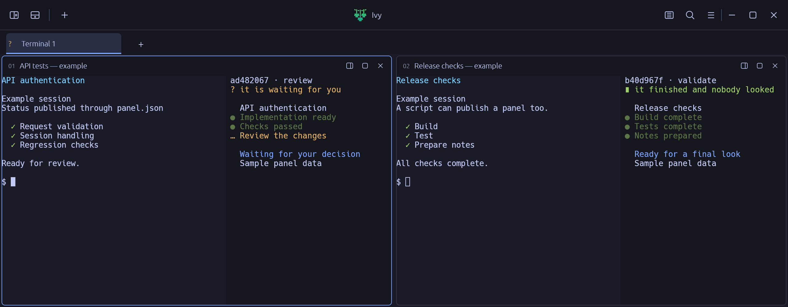
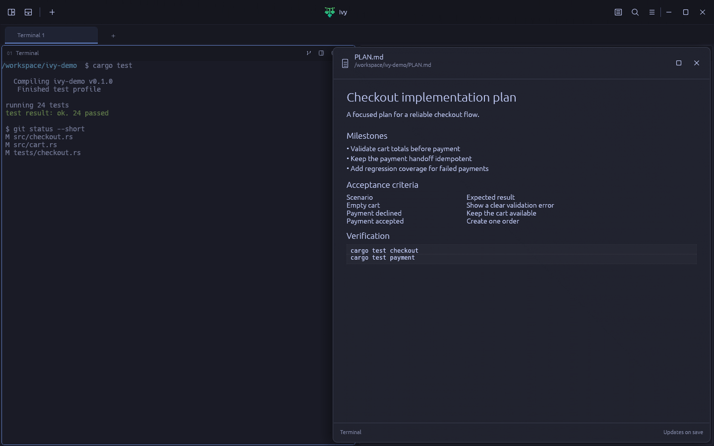
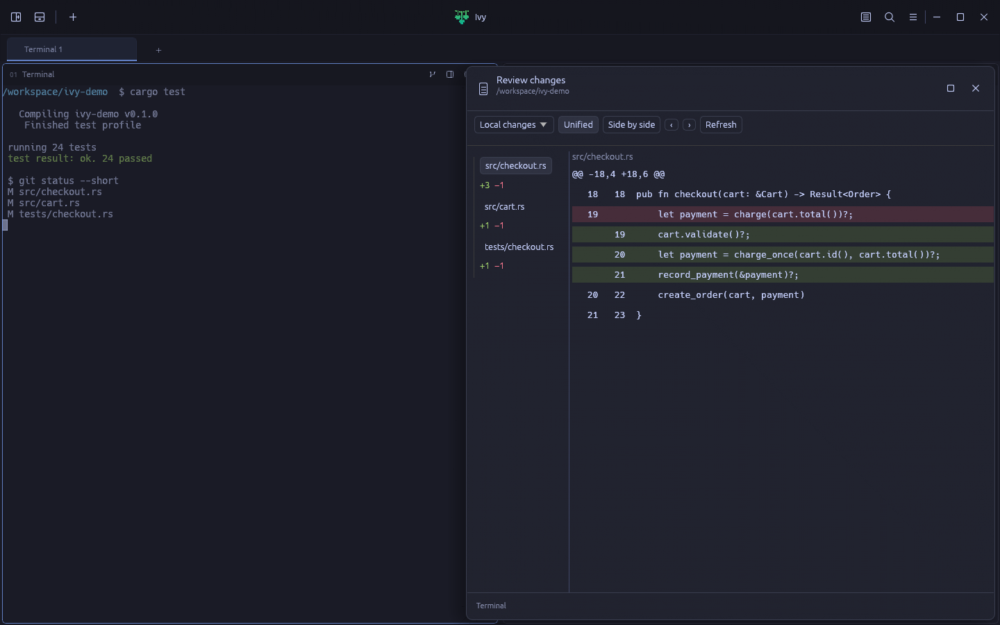

<p align="center">
  
</p>

<h1 align="center">Ivy</h1>

<p align="center"><strong>A terminal for working with several agents at once.</strong></p>

<p align="center">
  <a href="#get-started">Get started</a> ·
  <a href="#publish-your-first-panel">Try a panel</a> ·
  <a href="#read-plans-and-review-changes">Read and review</a> ·
  <a href="docs/08-configuration.md">Configuration</a>
</p>

Run your usual shells and coding agents in tabs and movable panes. Give each task a status panel
and see which one needs you, without reading through every console.



*A real Ivy window with example sessions and sample panel data, using the Tokyo Night theme.*

## Your tools, with a shared view of the work

Start Claude Code, Codex, OpenCode, Gemini CLI, or another command-line tool as you normally would.
Ivy provides the terminal around it: the layout, the consoles and a place to publish what each task
is doing.

**Status comes from the tool doing the work.** An agent, a CI job or a shell script publishes its
own panel through `panel.json` or MCP. Ivy does not guess progress from terminal output, and a
client does not gain a panel just by being launched. With no producer connected, each pane is
still a regular terminal.

| Feature | What you get |
|---|---|
| **Tabs and movable panes** | Group work by project, split consoles, drag them into place and resize neighboring panes independently. |
| **A panel for each task** | Read the current step, notes, blockers and any other information its producer publishes. Resize or fold the panel away. |
| **Attention across the workspace** | Producers declare when they need you, are blocked or have finished. Tab indicators and Overview bring those claims together. |
| **Actions and MCP** | Producers can offer buttons with visible commands. Connected agents can publish and update panels, and open auxiliary consoles. |
| **Shared file explorer** | Browse files in a collapsible overlay, retain separate navigation for each console, and pin one console while working in another. |
| **Markdown previews** | Ctrl-click a local Markdown path to read formatted plans and notes in a floating viewer that updates on save. |
| **Git review beside the work** | Open a console's repository, compare changes in unified or side-by-side mode, and send reviewed comments back to that console. |
| **Everyday terminal controls** | Copy and paste, scrollback search, text selection, clickable web links and mouse support for terminal programs. |
| **A workspace of your own** | Optionally restore tabs, pane layout, directories and connected AI conversations; follow program-published pane titles or set manual names. |
| **Appearance and preferences** | Bundled themes, installed fonts, color emoji, optional programming ligatures, cursor settings and configurable shortcuts. |

AI recovery needs explicit [client integration setup](integrations/session-recovery/README.md);
Connect agents reports actual verified registration. Codex restores its last hook-reported session,
which can differ from the visible conversation after switching without sending a message. Claude
and OpenCode use their official live metadata interfaces. Verified capture currently targets Linux.

## Get started

These instructions are for a Linux desktop. Ivy opens one tab with one fresh console by default.
In **Settings → Startup**, choose **Layout**, **Layout and directories**, or **Layout, directories and AI sessions** to restore your arrangement
on later launches. Turning recovery off keeps the previous saved layout. Additional windows open
fresh and are temporary: they do not replace the first window's saved arrangement. AI recovery
requires explicit setup of the matching client adapter described above.

Experimental Ubuntu and Arch downloads are available in [Releases](https://github.com/mashware/ivy/releases).
The macOS delivery adds Apple Silicon and Intel DMG builders; see the
[installation and release guide](docs/10-installation.md) for the packages actually published and their trial status.
To build from source, you need:

- Git and [Rust installed through rustup](https://rustup.rs/). The repository selects its pinned
  toolchain from [`rust-toolchain.toml`](rust-toolchain.toml).
- A native compiler and linker for your system.
- A Linux desktop with X11 or Wayland, an OpenGL-capable graphics stack and the native libraries
  needed by the windowing and font dependencies.

```sh
git clone https://github.com/mashware/ivy.git
cd ivy
cargo run --locked -p app --release
```

Ivy opens your shell in two consoles. Launch your preferred tools inside them, use the title-bar
controls to add panes or tabs, and open **Preferences** from the application menu to customize it.

To build a binary for later use:

```sh
cargo build --locked -p app --release
./target/release/app
```

The product is called **Ivy**; the repository directory, Cargo package and executable still use
their existing names.

## Publish your first panel

Every console receives its own `PANEL_ID` and `PANEL_DIR`. Run this **inside an Ivy console**:

```sh
cat > "$PANEL_DIR/panel.json" <<'JSON'
{
  "v": 1,
  "phase": "review",
  "attention": "wait",
  "lines": [
    {"text": "My first Ivy panel", "style": "title"},
    {"text": "Implementation ready", "mark": "done"},
    {"text": "Review the changes", "mark": "wait"}
  ]
}
JSON
```

The panel appears beside that console. Replace the file to update it; the window notices without
waiting for terminal output. A producer can publish any text that helps explain its work.

The `attention` field tells Ivy whether the task is waiting for **you** (`wait`), blocked on
something else (`block`), or finished and awaiting a look (`done`). Omit it when the task has no
claim on your attention. Open **Overview** with `Ctrl+Shift+O` to inspect tasks across your tabs.

Producers can also publish action buttons. Each button shows the command it will send to the
program in that console before you click it. See the
[panel contract](docs/04-panel-contract.md) for the complete document format and action rules.

### Connect an MCP producer

Open **Connect agents** in Ivy's title bar or application menu and choose **Copy setup prompt**.
Paste it into your AI client inside Ivy to let it configure the connection and publish a test panel.
Manual setup and bridge diagnostics are available in the same guide. Its indicator highlights while no console has published a panel;
it does not claim to detect how your AI client is configured.

The terminal and its MCP bridge are separate executables: `app` opens Ivy, and `panel-mcp` connects
an agent's MCP client to its console. Running or building `app` alone does not build the bridge,
install it on your `PATH`, or register it with any agent client.

Build both executables:

```sh
cargo build --locked --workspace --release
```

1. Configure your agent's MCP client to launch `target/release/panel-mcp` using its absolute path.
   Each client has its own MCP configuration; Ivy does not edit it automatically.
2. Start that agent inside an Ivy console. Its MCP bridge inherits the console's `PANEL_ID` and
   `PANEL_DIR`, and uses them to reach the local endpoint when a panel or console tool is called.
   Do not hard-code a pane's directory in the client configuration: every console has its own.
3. The client starts the bridge and discovers its tools through MCP. The tool descriptions and
   parameter schemas tell the model how to call them.
4. With a complete inherited console identity and an existing pane directory, the bridge answers
   the MCP handshake with conditional instructions asking the agent to publish progress and
   attention changes. It does not wait for a control socket: Ivy can still be starting it. The
   agent checks availability with `panel_get`; actual calls validate and connect to that console.
   A client that passes server instructions to its model — Claude Code does — shows them to the
   agent. Missing/broken identity, a gone directory or an unsupported control channel gets none.
   Instructions ask; they do not schedule status updates on the agent's behalf.

**Configure once per AI client.** Normal package updates keep the saved registration and the stable
bridge path. An empty panel means no status has been published, not that setup was lost. In an
existing Claude Code session, reconnect the registered server from `/mcp`; for a server named
`ivy`, `/mcp reconnect ivy` is available in current Claude Code. If that running session does not
list the server, restart Claude in the same Ivy console and resume the conversation. Closing the
terminal or repeating the installation prompt is unnecessary. The first-time setup prompt remains
available under **Connect agents → Manual setup and diagnostics**.

If this client did not pass the bridge's server instructions to its agent, add this instruction to
the agent's session or project instructions:

> If this client did not pass you the bridge's server instructions, use Ivy's panel tools to publish
> your current task and update it when the phase or attention changes. Set attention to `wait` when
> you need my answer, `block` when an external dependency stops the task, and `done` when the work is
> finished. Omit attention during ordinary progress. An agent working for another agent in the same
> console must leave the panel alone. An agent started in a console of its own keeps its own panel.

The bridge exposes `panel_set`, `panel_get`, `panel_patch` and `panel_retire`, plus `split_open`,
`split_read` and `split_close` for auxiliary consoles owned by that connection. A person's input
into an auxiliary console revokes the agent's read and close handle. See the
[architecture](docs/03-architecture.md) and [contract](docs/04-panel-contract.md) for connection
and ownership rules.

### Codex: forward identity and check the launch mode

In `~/.codex/config.toml`, configure the local stdio bridge with its verified absolute path:

```toml
[mcp_servers.ivy]
command = "/absolute/path/to/panel-mcp"
env_vars = ["PANEL_ID", "PANEL_DIR"]
```

If an Ivy bridge entry already exists under another name, update that table and preserve its
command and other settings instead of adding a duplicate. `env_vars` forwards **variable names**
from the launching environment; never save a console's actual `PANEL_ID` or `PANEL_DIR` in `env`.
See the [official Codex MCP configuration](https://learn.chatgpt.com/docs/extend/mcp?surface=cli).

In a newly opened ordinary Bash, Zsh or Fish console, type `codex`, `codex resume <session-id>`
or `codex fork <session-id>`. On Linux and macOS, supported ordinary launches use the shared daemon and keep each conversation's panel
connected to its console. Eligibility depends on advertised client capabilities and the live protocol,
not on CLI or server version numbers.
Native macOS two-console panel isolation and live phone history/input require separate verification;
Linux regression fixtures do not establish native interoperability.
The same live conversation can therefore be used for remote control. Ivy leaves your Codex and shell
configuration unchanged, and preserves the daemon's remote-control preference. If you want remote
control, start it explicitly with `codex remote-control start`.

Ivy never adds `--no-daemon` automatically. Missing capabilities or a failed shared connection stop
the launch with a diagnostic. Other platforms and advanced options, including custom configuration,
profiles and security flags, run the original command with a panel-routing diagnostic. Explicit `--no-daemon`, remote launches and
administrative commands retain their own behavior. Existing aliases and functions take precedence;
`command codex`, absolute paths, custom shell arguments and unsupported shells bypass integration.
If automatic integration is unavailable, check the client's help before using `--no-daemon` in the
intended console. Never persist console identity values.

Before panel setup, Codex still opens normally and reports that its panel bridge is not configured.
Use the bundled, matching `panel-mcp` binary; the shared connection verifies the actual bridge before
associating it with a console. If a conversation is still active from before this integration and cannot be safely attached, leave
its old desktop session before resuming it here. Ivy does not restart a shared daemon to recover it.
A remote host reporting “connected” does not prove that its live conversation can load history or
accept input. Phone history, input and MCP panel publication were verified on Linux with CLI/server
0.167.2, including after saved-thread resume. Confirm those behaviors on your own device while the
desktop session remains open.

Tool discovery alone proves no connection to a console. Successful pane-tool calls prove a usable
connection; observe a test status beside the intended console to confirm the target. To verify
independent routing, launch two Codex sessions in separate Ivy consoles with distinct test statuses
and confirm each appears only beside its originating console. Without that observation, report
native two-console verification as incomplete rather than claiming isolation is proved.

## Read plans and review changes

Read the plan or inspect changes while your consoles keep running. **Files** opens on the left
edge; **Markdown** and **Git** share a drawer below the consoles, as two tabs. Open Files, Markdown
and **Board** from the title bar (or its menu when the window is narrow), drag a divider to resize,
or click the active button again to close it. Consoles resize beside Files and above the drawer;
switching tools preserves their sources and navigation. **Search** in Files lists matching names in
a floating list: **Enter** shows the match in the tree and **Ctrl+Enter** opens a Markdown match in the drawer.

### Markdown previews

Hold **Ctrl** and click a local `.md` path printed by an agent or shell. Ivy opens the document
inside the terminal, with headings, lists, tables and code. Saving the file updates the preview
without reopening it. Choose documents through **Files**, or return to the retained document with
**Markdown** in the title bar. **Maximize** on the drawer gives it the consoles' space; **Restore**
returns it to its previous height. Files stays beside the drawer either way, so you can choose
another document without leaving the reading view. Running consoles remain active underneath.



*Markdown rendered with example session data and the Tokyo Night theme in the earlier floating layout.*

### Git review from each console

Click the **branch icon** in a console's header (**Review changes**). The review opens that
console's local repository, even when another console has keyboard focus; no repository path
form is needed.

Choose **Local changes**, **Unstaged changes**, **Staged changes**, or **Against base**. Browse
changed files and hunks, switch between **Unified** and **Side by side**, and use line numbers
to anchor review comments. Local changes include untracked regular files.



*Ivy's Git review rendered with example repository changes and the Tokyo Night theme.*

Add a comment from a line, then choose **Preview comments** to read the complete message before
inserting it into the console that opened the review. Inserting does not press Enter: submit it
there when you are ready. The review does not stage, discard or commit changes.

See [viewer configuration and limits](docs/08-configuration.md#markdown-and-git-diff-viewers)
for directory discovery, supported files and platform behavior.

## Browse a console's files

Choose **Files** from the right tool bar to show the shared file explorer.
A compact toolbar sits above the project tree; hover its controls for action details. It follows the active
console and remembers that console's root, expanded folders, selected entry and scroll position.
Different worktrees and even two consoles in the same directory keep separate navigation.
**Pin this console** keeps its files visible while you type in another console or switch tabs;
**Follow active pane** returns to following focus. Closing the pinned console returns to following.

Use the triangles to expand folders, select a file with one click, and double-click or press Enter
to enter a directory or preview a regular Markdown file. Other file types and symlinks can be
selected and copied with **Copy path**; they are never executed. Arrow keys navigate the tree.
The Markdown viewer keeps its existing guard against changing documents with unsent review comments.

**Up** changes the explorer root, **Refresh** reloads it, and **Use console directory** resets it
to the console's latest known local directory. Browsing never changes the running program's working
directory. Later console directory changes leave the saved tree intact. Unknown or remote console
directories show an unavailable message. Missing directories and listing failures are shown explicitly.

The explorer shares the dock width with the other tools; drag its left edge to resize it.
Narrow windows hide the dock body until it fits again. **Hide** or Escape preserves navigation and pin
state. Clicking outside transfers keyboard input back to the console. Navigation is kept only while
Ivy is running; restarting starts with Files hidden and fresh navigation from restored console directories.

Listings load on one background worker. A directory above 4096 entries or 4 MiB of paths is refused
with an explanation. The window caches up to 32 listings / 16 MiB and displays up to 8192 tree rows;
open a directory as the root or collapse folders to reach more entries. A stalled local filesystem
can delay further listings, but the explorer can still be hidden and consoles remain responsive.

## Controls at a glance

| Action | Default control |
|---|---|
| New tab / close tab | `Ctrl+Shift+T` / `Ctrl+Shift+W` |
| Previous / next tab | `Ctrl+Shift+Left` / `Ctrl+Shift+Right` |
| Split right / split below | `Ctrl+Shift+D` / `Ctrl+Shift+B` |
| Close the focused pane | `Ctrl+Shift+X` |
| Move a pane | `Ctrl+Shift` + drag |
| Copy selection / paste | `Ctrl+Shift+C` / `Ctrl+Shift+V` |
| Search scrollback | `Ctrl+Shift+F` |
| Open Overview | `Ctrl+Shift+O` |
| Scroll a page | `Shift+PageUp` / `Shift+PageDown` |
| Scroll to top / bottom | `Shift+Home` / `Shift+End` |
| Open a console web link or local Markdown path | `Ctrl` + click |
| Review a console's Git changes | Branch icon in that console's header |

The title bars also expose controls with the mouse. Double-click a pane name to rename it.
Resize a panel by dragging its border; drag it closed to give the space back to the console.
Hold `Shift` to select text when a terminal program has requested the mouse.

## Make it yours

Open **Preferences** from the application menu to choose a theme, font, size, cursor behavior and
shortcuts. Saved changes apply to the running terminal. Cancel discards the draft.

The settings file is `$XDG_CONFIG_HOME/ivy/config`, or
`~/.config/ivy/config` when `XDG_CONFIG_HOME` is unset (`%APPDATA%\ivy\config` on Windows). For
example:

```ini
version = 1
theme = tokyonight
size = 14
cursor.blink = off
key.overview = ctrl+shift+o
```

You can edit it by hand; external edits are read on the next startup. The file is optional, and
Ivy reports invalid lines while applying the valid ones. The saved layout lives beside it in
`layout.json`. See [configuration](docs/08-configuration.md) for all settings, themes, shortcut
rules and client-published pane titles.

## Development

Ivy is written in Rust. The current application uses egui/eframe, with `alacritty_terminal` for
terminal emulation and `portable-pty` for pseudoterminals. Each console owns its terminal state
and producer connection; panel documents remain independent of the interface framework.

```sh
cargo test --workspace
cargo clippy --workspace --all-targets -- -D warnings
cargo fmt --all --check
cargo doc-check
```

Tests exercise real local pseudoterminals and sockets; an environment that forbids those cannot
run the full suite. For reproducible frame measurements, use
[`scripts/measure-frame.sh`](scripts/measure-frame.sh) and the methodology in the
[decisions](docs/02-decisions.md).

Found a bug or want to discuss a feature? [Open an issue](https://github.com/mashware/ivy/issues).
For a bug, include your platform, build revision and steps to reproduce it.

## Further reading

| Document | Contents |
|---|---|
| [Vision](docs/01-vision.md) | The problem Ivy addresses and who it is for |
| [Configuration](docs/08-configuration.md) | Preferences, themes, fonts, shortcuts and pane names |
| [Panel contract](docs/04-panel-contract.md) | Publish status, attention, links and action buttons |
| [Architecture](docs/03-architecture.md) | Components, transports and ownership boundaries |
| [Decisions](docs/02-decisions.md) | Design choices, alternatives and measurement evidence |
| [Landscape](docs/07-landscape.md) | Related tools and comparisons |
| [References](docs/06-references.md) | Technical research behind the terminal |


## License

Ivy is free and open-source software under the [GNU General Public License, version 3 only](LICENSE)
(`GPL-3.0-only`). You can use, modify and redistribute it, including commercially. Distributed
modified versions must provide the corresponding source under GPLv3 and preserve the required notices.
See [COPYRIGHT](COPYRIGHT) for authorship and [LICENSE](LICENSE) for the complete terms.

Third-party dependencies and bundled assets retain their own licenses. See
[third-party notices](THIRD-PARTY.md) for the vendored code, themes and test font included here.
