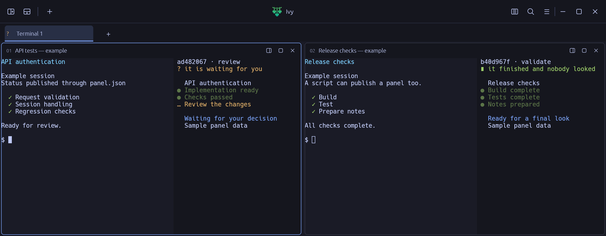
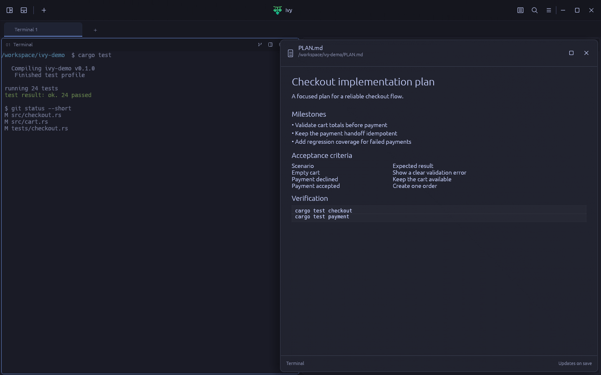
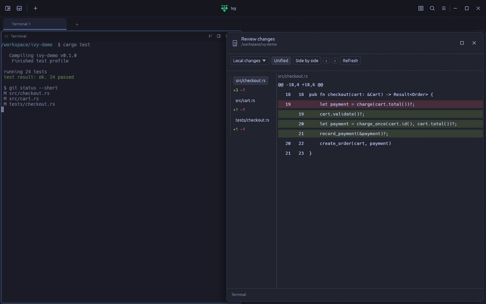

<p align="center">
  
</p>

<h1 align="center">Ivy</h1>

<p align="center"><strong>A terminal for working with several agents at once.</strong></p>

<p align="center">
  <a href="#get-started">Get started</a> ·
  <a href="#publish-your-first-panel">Try a panel</a> ·
  <a href="#read-plans-and-review-changes">Read and review</a> ·
  <a href="docs/08-configuration.md">Configuration</a>
</p>

Run your usual shells and coding agents in tabs and movable panes. Give each task a status panel
and see which one needs you, without reading through every console.



*A real Ivy window with example sessions and sample panel data, using the Tokyo Night theme.*

## Your tools, with a shared view of the work

Start Claude Code, Codex, OpenCode, Gemini CLI, or another command-line tool as you normally would.
Ivy provides the terminal around it: the layout, the consoles and a place to publish what each task
is doing.

**Status comes from the tool doing the work.** An agent, a CI job or a shell script publishes its
own panel through `panel.json` or MCP. Ivy does not guess progress from terminal output, and a
client does not gain a panel just by being launched. With no producer connected, each pane is
still a regular terminal.

| Feature | What you get |
|---|---|
| **Tabs and movable panes** | Group work by project, split consoles, drag them into place and resize neighboring panes independently. |
| **A panel for each task** | Read the current step, notes, blockers and any other information its producer publishes. Resize or fold the panel away. |
| **Attention across the workspace** | Producers declare when they need you, are blocked or have finished. Tab indicators and Overview bring those claims together. |
| **Actions and MCP** | Producers can offer buttons with visible commands. Connected agents can publish and update panels, and open auxiliary consoles. |
| **Markdown previews** | Ctrl-click a local Markdown path to read formatted plans and notes in a floating viewer that updates on save. |
| **Git review beside the work** | Open a console's repository, compare changes in unified or side-by-side mode, and send reviewed comments back to that console. |
| **Everyday terminal controls** | Copy and paste, scrollback search, text selection, clickable web links and mouse support for terminal programs. |
| **A workspace of your own** | Restore tabs, pane layout and panel widths; follow program-published pane titles or set manual names. |
| **Appearance and preferences** | Bundled themes, installed fonts, color emoji, optional programming ligatures, cursor settings and configurable shortcuts. |

## Get started

These instructions are for a Linux desktop. Reopening Ivy restores the layout and starts fresh
programs; it does not resume running agent sessions.

Build Ivy from source. You need:

- Git and [Rust installed through rustup](https://rustup.rs/). The repository selects its pinned
  toolchain from [`rust-toolchain.toml`](rust-toolchain.toml).
- A native compiler and linker for your system.
- A Linux desktop with X11 or Wayland, an OpenGL-capable graphics stack and the native libraries
  needed by the windowing and font dependencies.

```sh
git clone https://github.com/mashware/agent-terminal.git
cd agent-terminal
cargo run --locked -p app --release
```

Ivy opens your shell in two consoles. Launch your preferred tools inside them, use the title-bar
controls to add panes or tabs, and open **Preferences** from the application menu to customize it.

To build a binary for later use:

```sh
cargo build --locked -p app --release
./target/release/app
```

The product is called **Ivy**; the repository directory, Cargo package and executable still use
their existing names.

## Publish your first panel

Every console receives its own `PANEL_ID` and `PANEL_DIR`. Run this **inside an Ivy console**:

```sh
cat > "$PANEL_DIR/panel.json" <<'JSON'
{
  "v": 1,
  "phase": "review",
  "attention": "wait",
  "lines": [
    {"text": "My first Ivy panel", "style": "title"},
    {"text": "Implementation ready", "mark": "done"},
    {"text": "Review the changes", "mark": "wait"}
  ]
}
JSON
```

The panel appears beside that console. Replace the file to update it; the window notices without
waiting for terminal output. A producer can publish any text that helps explain its work.

The `attention` field tells Ivy whether the task is waiting for **you** (`wait`), blocked on
something else (`block`), or finished and awaiting a look (`done`). Omit it when the task has no
claim on your attention. Open **Overview** with `Ctrl+Shift+O` to inspect tasks across your tabs.

Producers can also publish action buttons. Each button shows the command it will send to the
program in that console before you click it. See the
[panel contract](docs/04-panel-contract.md) for the complete document format and action rules.

### Connect an MCP producer

Open **Connect agents** in Ivy's title bar or application menu and choose **Copy setup prompt**.
Paste it into your AI client inside Ivy to let it configure the connection and publish a test panel.
Manual setup and bridge diagnostics are available in the same guide. Its indicator highlights while no console has published a panel;
it does not claim to detect how your AI client is configured.

The terminal and its MCP bridge are separate executables: `app` opens Ivy, and `panel-mcp` connects
an agent's MCP client to its console. Running or building `app` alone does not build the bridge,
install it on your `PATH`, or register it with any agent client.

Build both executables:

```sh
cargo build --locked --workspace --release
```

1. Configure your agent's MCP client to launch `target/release/panel-mcp` using its absolute path.
   Each client has its own MCP configuration; Ivy does not edit it automatically.
2. Start that agent inside an Ivy console. Its MCP bridge inherits the console's `PANEL_ID` and
   `PANEL_DIR`, and uses them to reach the local endpoint when a panel or console tool is called.
   Do not hard-code a pane's directory in the client configuration: every console has its own.
3. The client starts the bridge and discovers its tools through MCP. The tool descriptions and
   parameter schemas tell the model how to call them.
4. Instruct the agent to publish its progress and attention changes. Tool discovery makes the
   operations available; it does not schedule status updates on the agent's behalf.

For example, add this instruction to the agent's session or project instructions:

> Use Ivy's panel tools to publish your current task and update it when the phase or attention changes.
> Set attention to `wait` when you need my answer, `block` when an external dependency stops the
> task, and `done` when the work is finished. Omit attention during ordinary progress.

It exposes `panel_set`, `panel_get`, `panel_patch` and `panel_retire`, plus `split_open`,
`split_read` and `split_close` for auxiliary consoles owned by that connection. A person's input
into an auxiliary console revokes the agent's read and close handle. See the
[architecture](docs/03-architecture.md) and [contract](docs/04-panel-contract.md) for connection
and ownership rules.

## Read plans and review changes

Read the plan or inspect changes while your consoles keep running. Both viewers float above the
panes, attached to the right edge. Drag the left edge to resize, expand the viewer, or close it;
the console layout stays in place.

### Markdown previews

Hold **Ctrl** and click a local `.md` path printed by an agent or shell. Ivy opens the document
inside the terminal, with headings, lists, tables and code. Saving the file updates the preview
without reopening it. You can also choose **Markdown viewer** from the application menu.



*Ivy's Markdown viewer rendered with example session data and the Tokyo Night theme.*

### Git review from each console

Click the **branch icon** in a console's header (**Review changes**). The review opens that
console's local repository, even when another console has keyboard focus; no repository path
form is needed.

Choose **Local changes**, **Unstaged changes**, **Staged changes**, or **Against base**. Browse
changed files and hunks, switch between **Unified** and **Side by side**, and use line numbers
to anchor review comments. Local changes include untracked regular files.



*Ivy's Git review rendered with example repository changes and the Tokyo Night theme.*

Add a comment from a line, then choose **Preview comments** to read the complete message before
inserting it into the console that opened the review. Inserting does not press Enter: submit it
there when you are ready. The review does not stage, discard or commit changes.

See [viewer configuration and limits](docs/08-configuration.md#markdown-and-git-diff-viewers)
for directory discovery, supported files and platform behavior.

## Controls at a glance

| Action | Default control |
|---|---|
| New tab / close tab | `Ctrl+Shift+T` / `Ctrl+Shift+W` |
| Previous / next tab | `Ctrl+Shift+Left` / `Ctrl+Shift+Right` |
| Split right / split below | `Ctrl+Shift+D` / `Ctrl+Shift+B` |
| Close the focused pane | `Ctrl+Shift+X` |
| Move a pane | `Ctrl+Shift` + drag |
| Copy selection / paste | `Ctrl+Shift+C` / `Ctrl+Shift+V` |
| Search scrollback | `Ctrl+Shift+F` |
| Open Overview | `Ctrl+Shift+O` |
| Scroll a page | `Shift+PageUp` / `Shift+PageDown` |
| Scroll to top / bottom | `Shift+Home` / `Shift+End` |
| Open a console web link or local Markdown path | `Ctrl` + click |
| Review a console's Git changes | Branch icon in that console's header |

The title bars also expose controls with the mouse. Double-click a pane name to rename it.
Resize a panel by dragging its border; drag it closed to give the space back to the console.
Hold `Shift` to select text when a terminal program has requested the mouse.

## Make it yours

Open **Preferences** from the application menu to choose a theme, font, size, cursor behavior and
shortcuts. Saved changes apply to the running terminal. Cancel discards the draft.

The settings file is `$XDG_CONFIG_HOME/agent-terminal/config`, or
`~/.config/agent-terminal/config` when `XDG_CONFIG_HOME` is unset. For example:

```ini
version = 1
theme = tokyonight
size = 14
cursor.blink = off
key.overview = ctrl+shift+o
```

You can edit it by hand; external edits are read on the next startup. The file is optional, and
Ivy reports invalid lines while applying the valid ones. The saved layout lives beside it in
`layout.json`. See [configuration](docs/08-configuration.md) for all settings, themes, shortcut
rules and client-published pane titles.

## Development

Ivy is written in Rust. The current application uses egui/eframe, with `alacritty_terminal` for
terminal emulation and `portable-pty` for pseudoterminals. Each console owns its terminal state
and producer connection; panel documents remain independent of the interface framework.

```sh
cargo test --workspace
cargo clippy --workspace --all-targets -- -D warnings
cargo fmt --all --check
cargo doc-check
```

Tests exercise real local pseudoterminals and sockets; an environment that forbids those cannot
run the full suite. For reproducible frame measurements, use
[`scripts/measure-frame.sh`](scripts/measure-frame.sh) and the methodology in the
[decisions](docs/02-decisions.md).

Found a bug or want to discuss a feature? [Open an issue](https://github.com/mashware/agent-terminal/issues).
For a bug, include your platform, build revision and steps to reproduce it.

## Further reading

| Document | Contents |
|---|---|
| [Vision](docs/01-vision.md) | The problem Ivy addresses and who it is for |
| [Configuration](docs/08-configuration.md) | Preferences, themes, fonts, shortcuts and pane names |
| [Panel contract](docs/04-panel-contract.md) | Publish status, attention, links and action buttons |
| [Architecture](docs/03-architecture.md) | Components, transports and ownership boundaries |
| [Decisions](docs/02-decisions.md) | Design choices, alternatives and measurement evidence |
| [Landscape](docs/07-landscape.md) | Related tools and comparisons |
| [References](docs/06-references.md) | Technical research behind the terminal |
